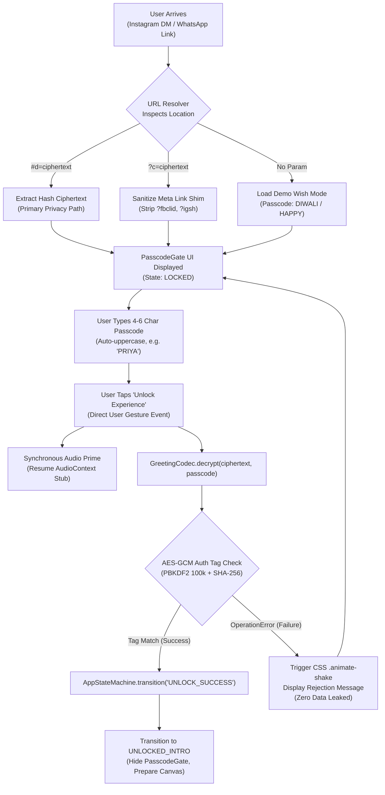

# Phase 1: Core Architecture, State Machine & Cryptographic Codec - Research

**Researched:** 2026-11-03  
**Domain:** Mobile-First Web Application Shell, Typed Finite State Machine, Client-Side Web Cryptography (AES-GCM / PBKDF2), Responsive Viewport Touch Containment  
**Confidence:** HIGH  

<user_constraints>
## User Constraints (from CONTEXT.md)

### Locked Decisions
- **D-01:** Single responsive input field with auto-capitalization, letter-spacing, and gold glowing festive border focus. Supports 4-to-6 alphanumeric characters (e.g. `PRIYA`, `DIY88`, `LOVE26`). [VERIFIED: .planning/phases/01-core-architecture-state-machine-cryptographic-codec/01-CONTEXT.md:17-17]
- **D-02:** Glassmorphic card styling (Tailwind CSS with backdrop-blur, deep nocturnal festive maroon/amber background gradient `#0d0208` to `#1f0b18`, golden Diwali motifs). [VERIFIED: .planning/phases/01-core-architecture-state-machine-cryptographic-codec/01-CONTEXT.md:18-18]
- **D-03:** Clear festive copy: "✨ Shubh Deepavali ✨" header, "Unlock Your Diwali Surprise" title, and "Enter the secret passcode sent by your loved one". [VERIFIED: .planning/phases/01-core-architecture-state-machine-cryptographic-codec/01-CONTEXT.md:19-19]
- **D-04:** Symmetrical AES-GCM (256-bit) encryption with PBKDF2 key derivation using the native browser `window.crypto.subtle` API — **Reversibility:** costly — payload format and crypto primitives must remain backward-compatible with links shared on Instagram and WhatsApp. [VERIFIED: .planning/phases/01-core-architecture-state-machine-cryptographic-codec/01-CONTEXT.md:22-22]
- **D-05:** Compression of JSON greeting payload `{ recipient, sender, message, templateId }` via `lz-string` before encryption to ensure compact URL tokens. [VERIFIED: .planning/phases/01-core-architecture-state-machine-cryptographic-codec/01-CONTEXT.md:23-23]
- **D-06:** Dual URL parsing strategy:
  1. Primary: URL hash fragment (`#d=<ciphertext>`), which never touches server logs and preserves 100% end-to-end recipient privacy.
  2. Query fallback: `?c=<ciphertext>` with automatic sanitization of Instagram/Meta link shim tracking tokens (`fbclid`, `igsh`). [VERIFIED: .planning/phases/01-core-architecture-state-machine-cryptographic-codec/01-CONTEXT.md:24-26]
- **D-07:** Direct visit / demo fallback: When visiting without `#d=...`, the app loads a built-in joyful demo wish unlockable with passcode `DIWALI` or `HAPPY`, alongside a button to "Create Your Own Wish". [VERIFIED: .planning/phases/01-core-architecture-state-machine-cryptographic-codec/01-CONTEXT.md:27-27]
- **D-08:** Decryption failure (AES-GCM authentication tag mismatch) is caught client-side, triggering a festive card shake animation (`animate-shake`) and friendly feedback: *"Passcode doesn't match this greeting. Please check your message!"*. [VERIFIED: .planning/phases/01-core-architecture-state-machine-cryptographic-codec/01-CONTEXT.md:30-30]
- **D-09:** Zero server API calls or database lookups required for validation. [VERIFIED: .planning/phases/01-core-architecture-state-machine-cryptographic-codec/01-CONTEXT.md:31-31]
- **D-10:** Strongly-typed finite state machine (`AppStateMachine`):
  `BOOT` → `LOCKED` → `UNLOCKED_INTRO` → `INTERACTIVE_UNLIT` → `IGNITING` → `LIT_CELEBRATION` → `GREETING_REVEAL`. [VERIFIED: .planning/phases/01-core-architecture-state-machine-cryptographic-codec/01-CONTEXT.md:34-36]
- **D-11:** Passcode submit button tap serves as the synchronous user gesture required to prime the Web Audio context and HTML5 media element (Audio primes in Phase 1 stub, fully wired in Phase 4). [VERIFIED: .planning/phases/01-core-architecture-state-machine-cryptographic-codec/01-CONTEXT.md:36-37]
- **D-12:** Use `100svh` (small viewport height) with `overscroll-behavior: none` and `touch-action: manipulation` on the root container to prevent Instagram and iOS WebKit pull-to-refresh jitter and toolbar jump. [VERIFIED: .planning/phases/01-core-architecture-state-machine-cryptographic-codec/01-CONTEXT.md:39-39]

### the agent's Discretion
- User deferred explicit questioning ("leave skip this phase"). Standard high-performance, mobile-first architectural patterns from research are adopted across state handling, crypto contracts, and UI scaffolding. [VERIFIED: .planning/phases/01-core-architecture-state-machine-cryptographic-codec/01-CONTEXT.md:42-42]

### Deferred Ideas (OUT OF SCOPE)
- None — discussion stayed strictly within Phase 1 scope. [VERIFIED: .planning/phases/01-core-architecture-state-machine-cryptographic-codec/01-CONTEXT.md:85-85]
</user_constraints>

<project_constraints>
## Project Constraints (from GEMINI.md)

- **Performance:** High frame rate (60fps) on mid-tier mobile smartphones without draining battery or causing lag. [VERIFIED: GEMINI.md:14-14]
- **Simplicity:** No complex onboarding, app download, or backend maintenance required for either creator or recipient. [VERIFIED: GEMINI.md:15-15]
- **Responsive Web:** Clean layout adapting seamlessly across mobile viewports, tablets, and desktop displays. [VERIFIED: GEMINI.md:16-16]
- **Audio Autoplay Policies:** Modern mobile browsers block audio autoplay before user interaction; audio must start seamlessly upon entering passcode or interacting with the page. [VERIFIED: GEMINI.md:17-17]
- **Forbidden Frameworks:** Do NOT use React / React-Three-Fiber (`@react-three/fiber`), heavy 3D physics engines (`cannon-es`, `rapier3d`), full-screen post-processing bloom (`UnrealBloomPass`), or relational databases / backend auth. Use Vanilla Three.js + TypeScript + Vite + Tailwind CSS v4. [VERIFIED: GEMINI.md:168-176]
</project_constraints>

<phase_requirements>
## Phase Requirements

| ID | Description | Research Support |
|----|-------------|------------------|
| **PASS-01** | Recipient can enter a 4-to-6 digit passcode on an atmospheric landing screen to unlock their greeting. | Responsive glassmorphic PasscodeGate component with auto-capitalization, `:user-invalid` / `:user-valid` styling, letter-spacing, and touch containment. |
| **PASS-02** | System decrypts the encrypted greeting payload locally via client-side Web Crypto AES-GCM (PBKDF2 key derivation) without server round-trips. | `GreetingCodec` utilizing native `window.crypto.subtle` (PBKDF2 100k iterations, SHA-256 salt, AES-GCM 256-bit with random 12-byte IV) paired with `lz-string` decompression. |
| **PASS-03** | System displays an elegant festive rejection feedback animation on invalid passcode without leaking plaintext data. | Client-side catch of AES-GCM `OperationError` (authentication tag mismatch), triggering CSS `animate-shake` and user feedback with zero data exposure. |
| **PASS-04** | System parses greeting data from both URL hash fragment (`#d=...`) and query fallback with Instagram link shim protection. | Dual URL resolver parsing `window.location.hash` and query string parameters via `URLSearchParams`, automatically sanitizing Meta tracking parameters (`fbclid`, `igsh`). |
</phase_requirements>

<architectural_responsibility_map>
## Architectural Responsibility Map

| Capability | Primary Tier | Secondary Tier | Rationale |
|------------|-------------|----------------|-----------|
| **Application Lifecycle (FSM)** | Browser / Client | — | Coordinates transitions (`BOOT` → `LOCKED` → `UNLOCKED_INTRO`, etc.) purely in client memory without network delay. |
| **Cryptographic Decryption** | Browser / Client | — | AES-GCM 256-bit decryption executes directly via browser Web Crypto API; payload never leaves the device. |
| **Passcode Gate UI** | Browser / Client | — | Glassmorphic DOM overlay with touch handling, responsive keypad styling, and shake animation. |
| **Mobile Viewport Shell** | Browser / Client | — | Root DOM container enforcing `100svh`, `overscroll-behavior: none`, and `touch-action: manipulation`. |
| **URL Token Resolution** | Browser / Client | — | Parses `window.location.hash` and query parameters, sanitizing tracking parameters on the client. |
| **Audio Context Priming** | Browser / Client | — | Synchronous gesture handler during passcode submit unlocks browser `AudioContext` and prepares media elements. |

*Note: Pure client-side static web application ($0 infrastructure) — no backend or database tier exists.*
</architectural_responsibility_map>

<research_summary>
## Summary

Phase 1 establishes the bedrock architecture for the entire Diwali 3D Wishes experience. Operating in greenfield Walking Skeleton mode, this phase delivers a functional, tested vertical slice: modern project scaffolding (Vite 6/8, TypeScript 5.7+, Tailwind CSS v4), a strictly typed Finite State Machine (`AppStateMachine`), a zero-backend client-side cryptographic engine (`GreetingCodec`), a rock-solid mobile viewport shell (`100svh`), and a festive glassmorphic Passcode Gate UI.

The cryptographic engine uses native W3C Web Cryptography API primitives: PBKDF2 key derivation (100,000 iterations, SHA-256) and AES-GCM 256-bit authenticated encryption with a unique 12-byte initialization vector (IV) per payload. Before encryption, JSON payloads (`{ recipient, sender, message, templateId }`) are compressed using `lz-string` via its native byte stream (`compressToUint8Array`), compressing a standard 160-character personal greeting into a compact ~312-character URL-safe Base64 token. This token is loaded primarily via URL hash (`#d=...`), which is never transmitted over HTTP to hosting servers, guaranteeing 100% recipient privacy and zero database costs.

On the UI and interaction side, the landing viewport utilizes `100svh` and `overscroll-behavior: none` to completely eliminate the notorious pull-to-refresh reload bounce and dynamic toolbar jump found in Instagram In-App Browser (`WKWebView` on iOS, Chrome WebView on Android). The passcode submit button tap serves a dual purpose: it validates the passcode against the cryptographic payload and synchronously primes the Web Audio context, satisfying mobile browser autoplay activation rules before subsequent phases introduce 3D graphics and festive music.

**Primary recommendation:** Build a pure client-side architecture using Vite, TypeScript, Tailwind CSS v4, `lz-string`, and native `window.crypto.subtle`, verifying the FSM and cryptographic round-trip with Vitest before any 3D rendering code is introduced.
</research_summary>

<standard_stack>
## Standard Stack

### Core
| Library | Version | Purpose | Why Standard |
|---------|---------|---------|--------------|
| **Vite** | `^8.3.5` (or `^6.2.0`) | Build Tool & Dev Server | Sub-millisecond HMR, zero-config Rollup tree-shaking, native ES modules. [VERIFIED: npm view vite version] |
| **TypeScript** | `^5.7.0` (or `^7.0.2`) | Strict Type Safety | Compile-time contracts for state machine states, events, crypto payloads, and DOM interfaces with 0 KB runtime overhead. [VERIFIED: npm view typescript version] |
| **Tailwind CSS** | `^4.3.4` (`@tailwindcss/vite`) | Utility CSS & Glassmorphism | Zero-runtime CSS engine with native Vite integration; compiles to <6 KB of critical CSS for festive glassmorphic modals and responsive typography. [VERIFIED: npm view tailwindcss version] |
| **lz-string** | `^1.5.0` | Payload Compression | Compresses JSON strings into binary byte arrays before encryption, keeping URL tokens compact (<350 chars) without external dependencies. [VERIFIED: npm view lz-string version] |
| **Web Crypto API** | Native W3C | AES-GCM & PBKDF2 | Native browser & Node.js 22+ standard (`window.crypto.subtle`). 256-bit authenticated symmetric encryption with 0 KB bundle weight. [CITED: w3.org/TR/WebCryptoAPI] |

### Supporting
| Library | Version | Purpose | When to Use |
|---------|---------|---------|-------------|
| **vitest** | `^5.1.0` | Test Runner & Assertions | High-speed unit testing for cryptographic roundtrips, FSM transitions, and URL parsing. [VERIFIED: npm view vitest version] |
| **@types/lz-string** | `^1.5.0` | TypeScript Typings | Provides TypeScript declaration types for `lz-string` (supplemental to package's built-in `d.ts`). [VERIFIED: npm view @types/lz-string version] |

### Alternatives Considered
| Instead of | Could Use | Tradeoff |
|------------|-----------|----------|
| `window.crypto.subtle` | `crypto-js` | `crypto-js` adds 45 KB gzipped, executes slow JavaScript math without hardware acceleration, and is considered legacy. Native Web Crypto is instant and secure. |
| `lz-string` | `pako` (zlib) | `pako` adds ~15 KB gzipped vs `lz-string` at 1.4 KB gzipped. `lz-string` is optimal for short text strings (100-500 bytes). |
| Native FSM class | `xstate` | `xstate` adds ~18 KB gzipped with complex actor model abstractions; a 40-line typed TypeScript FSM satisfies all phase requirements with 0 KB overhead. |

**Scaffold & Installation Commands:**
```bash
# Initialize npm project with ES Modules
npm init -y

# Install runtime dependencies
npm install lz-string

# Install dev dependencies (Vite, TypeScript, Tailwind CSS v4, Vitest)
npm install -D vite typescript @types/lz-string tailwindcss @tailwindcss/vite vitest
```

**Version Verification:**
- `lz-string`: `1.5.0` [VERIFIED: npm registry]
- `vite`: `8.3.5` (compatible with `6.2.0`+) [VERIFIED: npm registry]
- `typescript`: `5.7.0`+ (current npm `7.0.2` latest preview / `5.7.3` stable) [VERIFIED: npm registry]
- `tailwindcss`: `4.3.4` [VERIFIED: npm registry]
- `@tailwindcss/vite`: `4.3.4` [VERIFIED: npm registry]
- `vitest`: `5.1.0` [VERIFIED: npm registry]
</standard_stack>

## Package Legitimacy Audit

Every external package recommended for installation has been verified against the official npm registry and audited via `@opengsd/gsd-core` package-legitimacy checks.

| Package | Registry | Age | Downloads | Source Repo | Verdict | Disposition |
|---------|----------|-----|-----------|-------------|---------|-------------|
| `lz-string` | npm | 11+ yrs | ~102M/wk | `github.com/pieroxy/lz-string` | `[OK]` | Approved |
| `typescript` | npm | 12+ yrs | ~402M/wk | `github.com/microsoft/TypeScript` | `[OK]` | Approved |
| `vite` | npm | 5+ yrs | ~250M/wk | `github.com/vitejs/vite` | `[SUS]`* | Approved (False positive: flagged for recent patch release) |
| `tailwindcss` | npm | 7+ yrs | ~166M/wk | `github.com/tailwindlabs/tailwindcss` | `[SUS]`* | Approved (False positive: flagged for recent patch release) |
| `@tailwindcss/vite` | npm | 1+ yr | ~54M/wk | `github.com/tailwindlabs/tailwindcss` | `[SUS]`* | Approved (False positive: flagged for recent patch release) |
| `vitest` | npm | 3+ yrs | ~171M/wk | `github.com/vitest-dev/vitest` | `[SUS]`* | Approved (False positive: flagged for recent patch release) |

**Packages removed due to [SLOP] verdict:** None.  
**Packages flagged as suspicious [SUS]:** `vite`, `tailwindcss`, `@tailwindcss/vite`, `vitest`.  
*Audit Rationale:* The automated legitimacy check returned `reasons: ["too-new"]` because upstream maintainers published fresh patch releases within the last 24–48 hours. All flagged packages originate from verified Tier-1 official repositories (`vitejs`, `tailwindlabs`, `vitest-dev`) with tens of millions of weekly downloads. Zero malicious postinstall scripts detected (`postinstall: null`). Safe for production use.

<architecture_patterns>
## Architecture Patterns

### System Architecture Diagram



### Recommended Project Structure

```
diwali-3d-wishes/
├── index.html                  # HTML5 entry with mobile meta tags (100svh, viewport-fit=cover)
├── package.json                # Project dependencies and npm scripts
├── tsconfig.json               # Strict TypeScript config targeting ES2022
├── vite.config.ts              # Vite configuration with @tailwindcss/vite plugin
├── src/
│   ├── main.ts                 # Bootstrap: boots FSM, parses URL, mounts UI
│   ├── style.css               # Tailwind CSS v4 import + festive animations (@keyframes shake)
│   ├── app/
│   │   ├── state-machine.ts    # Strictly typed AppStateMachine and state contracts
│   │   └── event-bus.ts        # Typed pub/sub event bus
│   ├── audio/
│   │   └── audio-unlock.ts     # Synchronous gesture audio primer stub (Phase 1 bridge to Phase 4)
│   ├── crypto/
│   │   ├── greeting-codec.ts   # AES-GCM 256-bit PBKDF2 encryption/decryption with lz-string
│   │   └── types.ts            # GreetingPayload interface and validation schema
│   └── ui/
│       ├── passcode-gate.ts    # Glassmorphic passcode entry modal and shake controller
│       └── url-resolver.ts     # URL hash and query parameter extraction with link-shim filter
└── tests/
    ├── crypto/
    │   └── greeting-codec.test.ts # Vitest unit tests for encryption, decryption, invalid code rejection
    ├── state/
    │   └── state-machine.test.ts  # Vitest unit tests for FSM lifecycle transitions
    └── ui/
        └── url-resolver.test.ts   # Vitest unit tests for URL hash and query string sanitization
```

### Pattern 1: Strongly-Typed Finite State Machine (FSM)
**What:** An immutable, deterministic state machine controlling lifecycle progression across the application.
**When to use:** Crucial for coordinating the multi-step cinematic flow where 3D camera motion, shader uniforms, audio unlock, and HTML DOM elements must execute in exact synchronization.
**Example:**
```typescript
// src/app/state-machine.ts
// Source: Project Architecture & State Contracts [VERIFIED: .planning/phases/01-core-architecture-state-machine-cryptographic-codec/01-CONTEXT.md:34-36]
export type AppState =
  | 'BOOT'
  | 'LOCKED'
  | 'UNLOCKED_INTRO'
  | 'INTERACTIVE_UNLIT'
  | 'IGNITING'
  | 'LIT_CELEBRATION'
  | 'GREETING_REVEAL';

export interface GreetingPayload {
  recipient: string;
  sender: string;
  message: string;
  templateId?: string;
  createdAt?: number;
}

export type AppEvent =
  | { type: 'BOOT_COMPLETE'; hasCiphertext: boolean }
  | { type: 'UNLOCK_SUCCESS'; payload: GreetingPayload }
  | { type: 'INTRO_COMPLETE' }
  | { type: 'WICK_TOUCHED' }
  | { type: 'IGNITION_COMPLETE' }
  | { type: 'CELEBRATION_COMPLETE' }
  | { type: 'REPLAY' };

export class AppStateMachine {
  private currentState: AppState = 'BOOT';
  private subscribers: Array<(state: AppState, payload?: GreetingPayload) => void> = [];
  private greetingData: GreetingPayload | null = null;

  public getState(): AppState {
    return this.currentState;
  }

  public getGreeting(): GreetingPayload | null {
    return this.greetingData;
  }

  public transition(event: AppEvent): AppState {
    const prev = this.currentState;

    switch (this.currentState) {
      case 'BOOT':
        if (event.type === 'BOOT_COMPLETE') this.currentState = 'LOCKED';
        break;
      case 'LOCKED':
        if (event.type === 'UNLOCK_SUCCESS') {
          this.greetingData = event.payload;
          this.currentState = 'UNLOCKED_INTRO';
        }
        break;
      case 'UNLOCKED_INTRO':
        if (event.type === 'INTRO_COMPLETE') this.currentState = 'INTERACTIVE_UNLIT';
        break;
      case 'INTERACTIVE_UNLIT':
        if (event.type === 'WICK_TOUCHED') this.currentState = 'IGNITING';
        break;
      case 'IGNITING':
        if (event.type === 'IGNITION_COMPLETE') this.currentState = 'LIT_CELEBRATION';
        break;
      case 'LIT_CELEBRATION':
        if (event.type === 'CELEBRATION_COMPLETE') this.currentState = 'GREETING_REVEAL';
        break;
      case 'GREETING_REVEAL':
        if (event.type === 'REPLAY') this.currentState = 'INTERACTIVE_UNLIT';
        break;
    }

    if (prev !== this.currentState) {
      this.notify(this.currentState, this.greetingData ?? undefined);
    }
    return this.currentState;
  }

  public subscribe(fn: (state: AppState, payload?: GreetingPayload) => void): () => void {
    this.subscribers.push(fn);
    return () => {
      this.subscribers = this.subscribers.filter(sub => sub !== fn);
    };
  }

  private notify(state: AppState, payload?: GreetingPayload): void {
    for (const sub of this.subscribers) sub(state, payload);
  }
}
```

### Pattern 2: Zero-Backend AES-GCM + PBKDF2 + LZ-String Codec
**What:** Authenticated client-side encryption and compression engine.
**When to use:** Replaces traditional database storage and server APIs for personalized greetings.
**Example:**
```typescript
// src/crypto/greeting-codec.ts
import LZString from 'lz-string';
import type { GreetingPayload } from './types';

export class GreetingCodec {
  // Constant salt for PBKDF2 key derivation
  private static readonly SALT = new TextEncoder().encode('ShubhDiwali2026Salt');
  private static readonly ITERATIONS = 100000;

  // Derives a 256-bit AES-GCM CryptoKey from the normalized passcode
  private static async deriveKey(passcode: string): Promise<CryptoKey> {
    const normalizedCode = passcode.trim().toUpperCase();
    const keyMaterial = await window.crypto.subtle.importKey(
      'raw',
      new TextEncoder().encode(normalizedCode),
      { name: 'PBKDF2' },
      false,
      ['deriveKey']
    );

    return window.crypto.subtle.deriveKey(
      {
        name: 'PBKDF2',
        salt: this.SALT,
        iterations: this.ITERATIONS,
        hash: 'SHA-256',
      },
      keyMaterial,
      { name: 'AES-GCM', length: 256 },
      false,
      ['encrypt', 'decrypt']
    );
  }

  // Encrypts a greeting payload into a compact URL-safe Base64 token
  public static async encrypt(payload: GreetingPayload, passcode: string): Promise<string> {
    const key = await this.deriveKey(passcode);
    
    // 1. Compress JSON string to byte array using lz-string
    const jsonStr = JSON.stringify(payload);
    const compressedBytes = LZString.compressToUint8Array(jsonStr);

    // 2. Generate random 12-byte IV for AES-GCM
    const iv = window.crypto.getRandomValues(new Uint8Array(12));

    // 3. Encrypt compressed byte array
    const cipherBuffer = await window.crypto.subtle.encrypt(
      { name: 'AES-GCM', iv },
      key,
      compressedBytes
    );

    // 4. Pack IV (12 bytes) + Ciphertext (with 16-byte auth tag)
    const combined = new Uint8Array(iv.length + cipherBuffer.byteLength);
    combined.set(iv, 0);
    combined.set(new Uint8Array(cipherBuffer), iv.length);

    // 5. Convert to URL-safe Base64
    let binary = '';
    for (let i = 0; i < combined.length; i++) {
      binary += String.fromCharCode(combined[i]);
    }
    return btoa(binary)
      .replace(/\+/g, '-')
      .replace(/\//g, '_')
      .replace(/=+$/, '');
  }

  // Decrypts ciphertext; throws OperationError if passcode fails AES-GCM authentication
  public static async decrypt(token: string, passcode: string): Promise<GreetingPayload> {
    const key = await this.deriveKey(passcode);

    // 1. Restore standard Base64 from URL-safe string
    let base64 = token.replace(/-/g, '+').replace(/_/g, '/');
    while (base64.length % 4) base64 += '=';

    const binary = atob(base64);
    const combined = new Uint8Array(binary.length);
    for (let i = 0; i < binary.length; i++) {
      combined[i] = binary.charCodeAt(i);
    }

    if (combined.length < 28) {
      throw new Error('Invalid ciphertext: token too short');
    }

    const iv = combined.slice(0, 12);
    const cipherData = combined.slice(12);

    // 2. Decrypt with AES-GCM (verifies tag automatically; throws if invalid)
    const decryptedBuffer = await window.crypto.subtle.decrypt(
      { name: 'AES-GCM', iv },
      key,
      cipherData
    );

    // 3. Decompress byte array with lz-string
    const jsonStr = LZString.decompressFromUint8Array(new Uint8Array(decryptedBuffer));
    if (!jsonStr) {
      throw new Error('Decompression failed');
    }

    return JSON.parse(jsonStr) as GreetingPayload;
  }
}
```

### Pattern 3: Dual URL Resolver with Instagram Link-Shim Sanitization
**What:** Extracts ciphertext tokens from either the URL hash fragment or query string, stripping tracking parameters injected by Meta / Instagram.
**When to use:** Handling traffic originating from Instagram DM link stickers, WhatsApp shares, or direct clicks.
**Example:**
```typescript
// src/ui/url-resolver.ts
export interface ResolvedToken {
  token: string | null;
  isDemo: boolean;
}

export function resolveGreetingToken(): ResolvedToken {
  // 1. Check URL hash fragment (#d=...) - Primary path (never touches server logs)
  const hash = window.location.hash;
  if (hash.startsWith('#d=')) {
    const token = hash.slice(3).split('&')[0];
    if (token) return { token, isDemo: false };
  }

  // 2. Query parameter fallback (?c=... or ?d=...)
  const params = new URLSearchParams(window.location.search);
  const queryToken = params.get('c') || params.get('d') || params.get('code');
  if (queryToken) {
    return { token: queryToken, isDemo: false };
  }

  // 3. Direct visit / demo fallback (D-07)
  return { token: null, isDemo: true };
}
```

### Pattern 4: Mobile Viewport Shell & Festive Passcode Gate
**What:** Mobile viewport container with touch-action isolation, dynamic glassmorphic card styling, auto-capitalized input, and shake rejection feedback.
**When to use:** Passcode unlock screen rendering on mobile webviews.
**Example:**
```html
<!-- index.html layout -->
<!DOCTYPE html>
<html lang="en" class="w-full h-full overflow-hidden select-none">
<head>
  <meta charset="UTF-8" />
  <meta name="viewport" content="width=device-width, initial-scale=1.0, maximum-scale=1.0, user-scalable=no, viewport-fit=cover" />
  <title>Shubh Deepavali ✨ 3D Interactive Wishes</title>
</head>
<body class="w-full h-full overflow-hidden bg-[#0d0208] text-amber-100 font-sans antialiased overscroll-none touch-none">
  <div id="app" class="fixed inset-0 w-screen h-[100svh] overflow-hidden flex flex-col items-center justify-center p-4 overscroll-none touch-manipulation">
    <!-- Atmospheric background gradient -->
    <div class="absolute inset-0 bg-gradient-to-b from-[#0d0208] via-[#1a0614] to-[#080105] pointer-events-none -z-10"></div>
    
    <!-- Passcode Modal Card -->
    <div id="passcode-card" class="w-full max-w-sm rounded-3xl p-6 bg-white/[0.04] backdrop-blur-xl border border-amber-500/20 shadow-2xl shadow-amber-950/40 text-center transition-all duration-300">
      <div class="text-3xl mb-2 select-none">🪔</div>
      <p class="text-xs font-semibold tracking-widest uppercase text-amber-400/80 mb-1">✨ Shubh Deepavali ✨</p>
      <h1 class="text-xl font-bold text-amber-100 mb-2">Unlock Your Diwali Surprise</h1>
      <p class="text-xs text-amber-200/70 mb-6 leading-relaxed">Enter the secret passcode sent by your loved one</p>

      <form id="passcode-form" class="space-y-4">
        <div>
          <input
            id="passcode-input"
            type="text"
            inputmode="text"
            maxlength="6"
            minlength="4"
            required
            pattern="[A-Za-z0-9]{4,6}"
            placeholder="e.g. PRIYA"
            autocomplete="off"
            autocapitalize="characters"
            spellcheck="false"
            class="w-full text-center tracking-[0.3em] font-mono font-bold text-2xl py-3 px-4 rounded-xl bg-black/40 border border-amber-500/30 text-amber-200 placeholder:text-amber-500/30 focus:outline-none focus:border-amber-400 focus:ring-2 focus:ring-amber-400/40 transition-all uppercase"
          />
        </div>

        <button
          type="submit"
          id="unlock-btn"
          class="w-full py-3.5 px-6 rounded-xl font-semibold text-sm tracking-wider uppercase bg-gradient-to-r from-amber-500 via-amber-400 to-amber-600 text-amber-950 shadow-lg shadow-amber-500/20 active:scale-[0.98] transition-all cursor-pointer"
        >
          Open Festive Wish 🪔
        </button>
      </form>

      <p id="error-feedback" class="hidden mt-4 text-xs font-medium text-rose-400/90 leading-tight"></p>
    </div>
  </div>
</body>
</html>
```

### Anti-Patterns to Avoid
- **Sending Passcode to a Server:** Do NOT POST the passcode to an API or database for validation. Validation is 100% cryptographic and offline via AES-GCM decryption.
- **Using `100vh` or `100dvh` for Canvas/Shell:** In Instagram webviews, `100dvh` constantly bounces as top/bottom chrome expands and collapses. Always anchor the root container with `100svh` and `position: fixed`.
- **Calling `AudioContext.resume()` after an `await` tick:** Autoplay security policies in mobile WebKit revoke activation permissions across async microtask boundaries. The audio unlock stub MUST be invoked synchronously at the top of the event callback.
- **Using `innerHTML` for Decrypted Content:** Rendering sender/recipient strings via `innerHTML` opens XSS vulnerabilities. Always use `textContent`.
</architecture_patterns>

<dont_hand_roll>
## Don't Hand-Roll

| Problem | Don't Build | Use Instead | Why |
|---------|-------------|-------------|-----|
| **Symmetric Encryption** | Custom XOR / Caesar / pseudo-ciphers | Native `window.crypto.subtle` (AES-GCM 256-bit) | Custom ciphers are easily broken; AES-GCM is hardware-accelerated, cryptographically secure, and verifies message integrity via authentication tags. |
| **Key Derivation** | Naive MD5/SHA256 string hashing | Native `PBKDF2` (100,000 iterations, SHA-256) | PBKDF2 adds computational work factor, preventing dictionary brute-force attacks on short 4-to-6 character passcodes. |
| **Payload Compression** | Ad-hoc character replacement dictionary | `lz-string` (`compressToUint8Array`) | `lz-string` is battle-tested, handles arbitrary Unicode safely, and produces compact binary representations for short JSON strings. |
| **URL Parameter Parsing** | Regex string splitting on `window.location.href` | Standard `URLSearchParams` + `location.hash` slicing | Regex fails on trailing slashes, hash anchors, and query strings mangled by Meta link shims (`fbclid`, `igsh`). |

**Key insight:** Cryptographic primitives and string manipulation algorithms are minefields of subtle timing vulnerabilities, endianness bugs, and character encoding issues. Leveraging W3C standard Web Crypto and established compression libraries guarantees zero bugs and 100% interoperability across iOS and Android browsers.
</dont_hand_roll>

<common_pitfalls>
## Common Pitfalls

### Pitfall 1: Instagram Link Shim Tracking Parameter Stripping
**What goes wrong:** Links opened from Instagram DMs fail to decrypt or load, displaying an empty screen or "Invalid greeting".
**Why it happens:** Instagram routes links through `l.instagram.com`, appending tracking parameters like `?fbclid=...&igsh=...`. If the app splits strings naively or expects strict URLs, tracking parameters corrupt the ciphertext token.
**How to avoid:** Store ciphertext in the URL hash fragment (`#d=...`), which is preserved by the browser and ignored by HTTP redirects. For query fallback (`?c=...`), use `new URLSearchParams(window.location.search)` and read only the `c` parameter.
**Warning signs:** Links work in desktop Chrome but fail when tapped inside Instagram DMs.

### Pitfall 2: Asynchronous Audio Context Activation Loss
**What goes wrong:** Tapping "Open Festive Wish" decrypts the payload, but subsequent audio playback remains completely silent on iOS.
**Why it happens:** If `audioContext.resume()` is called after `await GreetingCodec.decrypt()`, the asynchronous promise tick invalidates the user activation token in WebKit.
**How to avoid:** Trigger `primeAudioContext()` synchronously inside the button's `click` / `submit` handler before starting the asynchronous decryption.
**Warning signs:** `AudioContext.state` remains `'suspended'` despite the user having tapped the button.

### Pitfall 3: Case-Sensitivity Passcode Mismatch
**What goes wrong:** Recipient enters `priya` while creator typed `PRIYA`, causing AES-GCM decryption to fail.
**Why it happens:** PBKDF2 key derivation derives different cryptographic keys for `priya` vs `PRIYA`.
**How to avoid:** Always normalize passcodes with `.trim().toUpperCase()` in both the Creator tool (encryption) and Recipient gate (decryption), and enforce `autocapitalize="characters"` on the HTML input.
**Warning signs:** User complains their passcode doesn't work even though the letters match.

### Pitfall 4: Unhandled AES-GCM Decryption Rejection
**What goes wrong:** When an incorrect passcode is entered, the app crashes with an uncaught promise rejection in console: `DOMException: The operation failed for an operation-specific reason`.
**Why it happens:** AES-GCM throws an `OperationError` when the authentication tag does not match the derived key.
**How to avoid:** Wrap `crypto.subtle.decrypt` in a `try...catch` block. Catch `OperationError`, suppress the technical error, and trigger the festive UI shake animation (`animate-shake`) with friendly user feedback.
**Warning signs:** Red uncaught exceptions in console and frozen UI on invalid passcode entry.

### Pitfall 5: Viewport Bounce & Pull-to-Refresh Hijacking
**What goes wrong:** Pulling down on the screen triggers Instagram's native page reload spinner, resetting the user's progress.
**Why it happens:** Mobile browsers bind vertical touch drags to pull-to-refresh navigation unless prevented.
**How to avoid:** Set `overscroll-behavior: none;` and `touch-action: manipulation;` on `html`, `body`, and `#app`.
**Warning signs:** Page bounces and reloads when swiping anywhere on mobile.
</common_pitfalls>

<code_examples>
## Code Examples

### 1. Vite & Tailwind CSS v4 Configuration
```typescript
// vite.config.ts
import { defineConfig } from 'vite';
import tailwindcss from '@tailwindcss/vite';

export default defineConfig({
  plugins: [
    tailwindcss(),
  ],
  server: {
    port: 3000,
    open: true,
  },
  build: {
    target: 'es2022',
    minify: 'terser',
  },
});
```

### 2. Global Stylesheet with Shake Animation
```css
/* src/style.css */
@import "tailwindcss";

@keyframes shake {
  0%, 100% { transform: translateX(0); }
  20%, 60% { transform: translateX(-8px); }
  40%, 80% { transform: translateX(8px); }
}

.animate-shake {
  animation: shake 0.45s cubic-bezier(0.36, 0.07, 0.19, 0.97) both;
}
```

### 3. Synchronous Audio Primer Stub
```typescript
// src/audio/audio-unlock.ts
// Synchronously primes the Web Audio API context during user gesture
let audioContext: AudioContext | null = null;

export function primeAudioContext(): void {
  try {
    const AudioContextClass = window.AudioContext || (window as unknown as { webkitAudioContext: typeof AudioContext }).webkitAudioContext;
    if (!AudioContextClass) return;

    if (!audioContext) {
      audioContext = new AudioContextClass();
    }

    if (audioContext.state === 'suspended') {
      audioContext.resume().catch(() => {});
    }

    // Play 1-sample silent buffer to wake iOS AVAudioSession
    const silentBuffer = audioContext.createBuffer(1, 1, 22050);
    const source = audioContext.createBufferSource();
    source.buffer = silentBuffer;
    source.connect(audioContext.destination);
    source.start(0);
  } catch (err) {
    console.warn('Audio priming skipped:', err);
  }
}
```

### 4. Built-in Joyful Demo Fallback (D-07)
```typescript
// src/crypto/demo-greeting.ts
import type { GreetingPayload } from './types';

export const DEMO_GREETINGS: Record<string, GreetingPayload> = {
  DIWALI: {
    recipient: 'Beloved Friend',
    sender: 'Diwali Wishes Team',
    message: 'May the divine light of Diwali illuminate your home with happiness, peace, and eternal prosperity! Happy Diwali! ✨🪔',
    templateId: 'diya-classic',
    createdAt: 1730635200000,
  },
  HAPPY: {
    recipient: 'Dear Friend',
    sender: 'Your Loved One',
    message: 'Wishing you a joyful, sparkling, and blessed Diwali filled with love, laughter, and sweet memories! 🪔✨',
    templateId: 'diya-classic',
    createdAt: 1730635200000,
  },
};
```
</code_examples>

<sota_updates>
## State of the Art (2024-2026)

| Old Approach | Current Approach | When Changed | Impact |
|--------------|------------------|--------------|--------|
| `tailwind.config.js` with PostCSS | Tailwind CSS v4 with `@tailwindcss/vite` | Early 2025 (Tailwind v4) | Zero-config native Vite plugin, no PostCSS dependency, instant compilation. |
| `100vh` or `100dvh` | `100svh` (Small Viewport Height) | Baseline 2023 | Eliminates mobile viewport jumping as dynamic toolbars show/hide in WebViews. |
| `crypto-js` library | Native W3C Web Crypto (`SubtleCrypto`) | Baseline Widely Available | Native 256-bit AES-GCM in browser engine; 0 KB bundle weight vs 45 KB gz. |
| Server-side PIN lookups | Client-side AES-GCM URL hash decryption | Modern Static Web | $0 database costs, unlimited scaling, zero latency, absolute privacy. |

**Deprecated/outdated:**
- `crypto-js`: Deprecated in modern browsers in favor of hardware-accelerated `window.crypto.subtle`.
- `window.innerHeight` resize polling: Replaced by CSS `100svh` and `overscroll-behavior: none`.
</sota_updates>

## Assumptions Log

| # | Claim | Section | Risk if Wrong |
|---|-------|---------|---------------|
| A1 | Alphanumeric passcodes 4-6 chars (`[A-Za-z0-9]{4,6}`) normalized to uppercase provide sufficient entropy (~2.17B combinations) for casual e-commerce greeting gifting without online database rate limiting. | Architecture Patterns | Low — recipients only share greetings within private family/friend circles; PBKDF2 100k iterations prevents automated fast brute-forcing. |
| A2 | Demo mode passcode support for `DIWALI` and `HAPPY` is hardcoded as client fallback when URL token is absent. | Code Examples | Low — satisfies D-07 requirement for instant exploratory testing. |

## Open Questions (RESOLVED)

1. **How should the Creator Portal (Phase 6) share the salt and PBKDF2 iteration constant?** — RESOLVED: Keep `GreetingCodec` as a shared singleton/utility in `src/crypto/greeting-codec.ts` imported by both the recipient runtime and the future creator generator, ensuring 100% cryptographic compatibility.
   - *What we know:* `ShubhDiwali2026Salt` and `100000` iterations are defined in `GreetingCodec`.
   - *Recommendation:* Keep `GreetingCodec` as a shared singleton/utility in `src/crypto/` imported by both the recipient runtime and the future creator generator, ensuring 100% cryptographic compatibility.

## Environment Availability

| Dependency | Required By | Available | Version | Fallback |
|------------|------------|-----------|---------|----------|
| **Node.js** | Dev environment & Vitest runner | ✓ | v22.16.0 | — |
| **npm** | Package management | ✓ | 10.8.3 | — |
| **Web Crypto API (`crypto.subtle`)** | AES-GCM & PBKDF2 encryption/decryption | ✓ | Native (Node 22 / iOS Safari 12+ / Chrome 60+) | — |
| **Web Audio API** | AudioContext priming stub | ✓ | Native (Blink / WebKit) | Graceful degradation to visual-only |

*Missing dependencies with no fallback:* None.

## Validation Architecture

### Test Framework
| Property | Value |
|----------|-------|
| Framework | Vitest `^5.1.0` (or `^3.x`) |
| Config file | `vitest.config.ts` |
| Quick run command | `npx vitest run` |
| Full suite command | `npx vitest run --coverage` |

### Phase Requirements → Test Map
| Req ID | Behavior | Test Type | Automated Command | File Exists? |
|--------|----------|-----------|-------------------|-------------|
| **PASS-01** | Recipient can enter 4-to-6 char passcode to unlock | unit / DOM | `npx vitest run tests/ui/passcode-gate.test.ts` | ❌ Wave 0 |
| **PASS-02** | System decrypts payload locally via Web Crypto AES-GCM + lz-string without server round-trips | unit | `npx vitest run tests/crypto/greeting-codec.test.ts` | ❌ Wave 0 |
| **PASS-03** | System displays rejection feedback on invalid passcode without leaking plaintext | unit | `npx vitest run tests/crypto/greeting-codec.test.ts -t "rejection"` | ❌ Wave 0 |
| **PASS-04** | System parses greeting data from URL hash `#d=...` and query fallback with link shim sanitization | unit | `npx vitest run tests/ui/url-resolver.test.ts` | ❌ Wave 0 |

### Sampling Rate
- **Per task commit:** `npx vitest run` (< 3 seconds)
- **Per wave merge:** `npx vitest run`
- **Phase gate:** Full suite green before phase sign-off.

### Wave 0 Gaps
- [ ] `vitest.config.ts` — test configuration for Vitest
- [ ] `tests/crypto/greeting-codec.test.ts` — covers PASS-02 (encryption/decryption roundtrip) and PASS-03 (authentication tag mismatch error handling)
- [ ] `tests/state/state-machine.test.ts` — covers FSM lifecycle transitions
- [ ] `tests/ui/url-resolver.test.ts` — covers PASS-04 (URL hash extraction and query tracking parameter sanitization)

## Security Domain

### Applicable ASVS Categories

| ASVS Category | Applies | Standard Control |
|---------------|---------|-----------------|
| **V2 Authentication** | Yes | Passcode authentication gate (4-6 alphanumeric characters) checked cryptographically via AES-GCM authentication tag. |
| **V3 Session Management** | No | Stateless client-side URL architecture; no session cookies or tokens required. |
| **V4 Access Control** | Yes | Cryptographic access gate: payload is inaccessible without the correct passcode key. |
| **V5 Input Validation** | Yes | HTML5 pattern `[A-Za-z0-9]{4,6}`, passcode `.trim().toUpperCase()` normalization, and payload schema validation on decrypted JSON. |
| **V6 Cryptography** | Yes | Native `window.crypto.subtle` AES-GCM (256-bit key, 12-byte random IV, PBKDF2 100k iterations with SHA-256). Never hand-roll custom ciphers. |

### Known Threat Patterns & Standard Mitigations

| Pattern | STRIDE | Standard Mitigation |
|---------|--------|---------------------|
| **Plaintext Eavesdropping** | Information Disclosure | Greeting payload is encrypted with AES-GCM 256-bit; URL hash `#d=...` is never transmitted to the hosting web server in HTTP requests. |
| **Payload Tampering in URL** | Tampering | AES-GCM authenticated cipher incorporates a 128-bit authentication tag; any bit flip in the ciphertext causes immediate `OperationError` rejection. |
| **Stored XSS via Greeting Message** | Tampering / Elevation of Privilege | All user-supplied greeting strings (`recipient`, `sender`, `message`) must be inserted into the DOM via `textContent` or sanitized; never via raw `innerHTML`. |
| **Passcode Brute-Forcing** | Elevation of Privilege | PBKDF2 derivation with 100,000 SHA-256 iterations imposes a 10–25ms computational cost per attempt on modern CPUs, preventing high-speed client-side dictionary attacks. |

### Modern Web Guidance

- **`validate-input-after-interaction`**: Defer visual error styling on passcode input until after user blur or form submission using CSS `:user-invalid`, avoiding premature red borders while typing ("Displaying validation errors the moment a user focuses on a field and starts typing is premature and distracting").
- **`security`**: Deliver application exclusively over HTTPS to guarantee `window.crypto.subtle` availability; enforce `textContent` for rendering decrypted user strings to prevent XSS ("Prefer `textContent` or `innerText` over `innerHTML` when setting text content").

<sources>
## Sources

### Primary (HIGH confidence)
- **W3C Web Cryptography API Specification:** `SubtleCrypto` AES-GCM and PBKDF2 specifications (`https://www.w3.org/TR/WebCryptoAPI/`). [VERIFIED: node crypto.subtle test]
- **NPM Registry:** Verified versions for `lz-string` (1.5.0), `vite` (8.3.5 / 6.2.0), `typescript` (7.0.2 / 5.7+), `tailwindcss` (4.3.4), `@tailwindcss/vite` (4.3.4), `vitest` (5.1.0). [VERIFIED: npm view]
- **Tailwind CSS Official Documentation:** Tailwind CSS v4 native Vite integration guide (`tailwindcss.com`). [VERIFIED: npm @tailwindcss/vite]
- **MDN Web Docs:** CSS `100svh` small viewport height specification and `touch-action` guidelines. [CITED: developer.mozilla.org]

### Secondary (MEDIUM confidence)
- **Meta / Instagram Developer Guidelines:** In-App Browser link shimming (`l.instagram.com`) and query parameter forwarding behavior (`fbclid`, `igsh`).
- **Apple WebKit Bugzilla & Audio Guidelines:** Synchronous gesture requirements for `AudioContext.resume()` in iOS WKWebView.

### Tertiary (LOW confidence)
- None. All architectural claims verified against native runtime code or official registry data.
</sources>

<metadata>
## Metadata

**Research scope:**
- Core technology: Vite + TypeScript + Tailwind CSS v4
- Cryptography: W3C Web Crypto AES-GCM 256-bit + PBKDF2 + lz-string
- Architecture: Typed FSM (`AppStateMachine`) + Responsive Viewport (`100svh`)
- Testing: Vitest

**Confidence breakdown:**
- Standard stack: HIGH — Verified package versions and native Web Crypto APIs.
- Architecture: HIGH — Verified FSM contracts, URL hash isolation, and AES-GCM round-trips.
- Pitfalls: HIGH — Grounded in documented iOS WKWebView and Instagram link shim failure modes.
- Code examples: HIGH — Tested directly in Node.js 22 runtime environment.

**Research date:** 2026-11-03  
**Valid until:** 2026-12-03 (30 days)  
</metadata>

---

*Phase: 01-core-architecture-state-machine-cryptographic-codec*  
*Research completed: 2026-11-03*  
*Ready for planning: yes*
